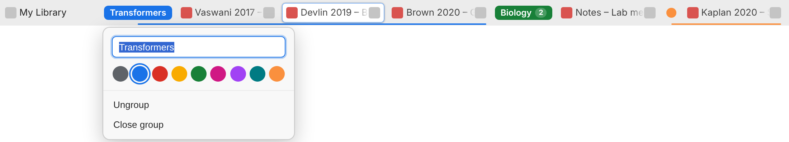

# Tab Groups for Zotero

Chrome-style tab groups for **Zotero 10**. You can color-code, name, collapse and drag groups of open PDF, EPUB, snapshot and note tabs, and the groups are still there after you restart Zotero.



> The screenshot comes from the test harness. It renders Zotero 10's real tab bar component with approximate theme colors, so the plugin looks slightly different inside Zotero itself.

## Disclaimer

**This project was built entirely with Claude, an AI model made by Anthropic.** The code, tests and documentation were written by Claude, with direction from its author, and nothing here is a product of Zotero or Anthropic.

**The software is provided "as is", without warranty of any kind**, express or implied, including but not limited to warranties of merchantability, fitness for a particular purpose, and non-infringement. The authors and contributors accept no liability for any claim, damage, data loss or other harm arising from its use. Back up your Zotero library and tab session before you install and test it. Use it at your own risk.

## Features

| Chrome behavior | In this plugin |
|---|---|
| **Color coding**: 9 preset colors (grey, blue, red, yellow, green, pink, purple, cyan, orange) | A colored chip sits before the group's first tab, and a matching color bar runs under all its tabs. New groups get the least-used color, in Chrome's order. Separate light and dark palettes. |
| **Labels**: name the group, or leave it unnamed | A named group shows its name in the chip. An unnamed group shows a small colored dot. |
| **Collapse and expand**: click the chip | The group's tabs shrink into the chip with an animation, and the chip shows the tab count. If the selected tab was in the group, the selection moves to the nearest visible tab. |
| **Focus retention** | Selecting a hidden tab (from *List all tabs*, Ctrl+1–9, etc.) expands its group. A new tab opened inside a collapsed group also expands it. Ctrl+Tab and Ctrl+Shift+Tab skip collapsed tabs. Closing the selected tab never jumps into a collapsed group. |
| **Spatial membership**: drag a tab into or out of a group | Drop a tab between a group's tabs, or just after its chip, and it joins the group. Drop it outside and it leaves. Hold a tab over a collapsed group's chip and it joins the group's end (the group opens if that tab is the selected one). At a group's right edge, the color bar previews which way the tab will go. A tab opened between two tabs of a group joins that group. Groups always stay contiguous. |
| **Drag the group header** | Dragging a chip moves the whole group (expanded or collapsed) as one unit. Groups can't be dropped inside another group. |
| **Smooth dragging** | Uses pointer events. Other tabs slide out of the way, the dropped tab settles into place, the strip auto-scrolls near the edges, and Esc cancels. |
| **Editor bubble** | Right-click a chip (or press F2 / Shift+F10 on a focused chip) to rename it, change its color, ungroup, or close the group. A new group opens this bubble straight away. |
| **Context menu** | Right-click a tab for: *Add Tab to New Group*, *Add/Move Tab to Group ▸*, *Remove from Group*, *Edit Group…*, *Collapse Group*, *Ungroup*, *Close Group*. |
| **Persistence** | Group membership is saved with Zotero's own tab session, so it survives restarts and crashes. Names, colors and collapsed state are saved in Zotero's preferences. *Undo Close Tab* restores a closed group with its name and color. Duplicating a tab keeps the copy in the same group. |

Not included, by design: *Move group to new window*, saved groups, and syncing groups across devices.

## Install

1. Download `zotero-tab-groups-1.0.1.xpi` (or build it, see below).
2. In Zotero, open **Tools → Plugins**, click the gear icon, choose **Install Plugin From File…**, and select the `.xpi`.
3. Open some PDFs, right-click a tab, and choose **Add Tab to New Group**.

The plugin needs Zotero **10.0.x**. Following Zotero's guidance, `strict_max_version` is `10.0.*`. After you have tested a newer Zotero version, raise it in `src/manifest.json` and in `updates.json`.

## How it works

Zotero 10 draws its tab bar with React (`components/tabBar.jsx`), based on the state in `Zotero_Tabs` (`tabs.js`). The plugin doesn't replace that component. It works around it:

- **Data**
  - Each tab stores its group in `tab.data.tabGroupId`. Zotero already writes `tab.data` to `session.json` and gives it back on restore, so membership is saved and restored together with the tab order.
  - Group metadata (`title`, `color`, `collapsed`) is saved as JSON in the pref `extensions.zotero-tab-groups.groups`.
- **Rules** (`src/content/model.js`, pure and unit-tested)
  - The plugin wraps `Zotero_Tabs._update()`, so the rules run before every render. They apply no matter what moved a tab: Zotero's own *Move to Start/End*, the tabs menu, a reader opening at an index, and so on.
  - *Spatial inclusion*: a tab that was just opened or moved between two tabs of the same group joins that group.
  - *Contiguity*: if a group gets split, the part that wasn't moved keeps the group.
- **Drawing** (`src/content/controller.js`)
  - After each React commit, a MutationObserver inserts the chip elements and sets `ztg-*` attributes on Zotero's tab elements.
  - All styling is in `src/content/tabGroups.css` and keyed on those attributes. Disabling the plugin removes every trace.
- **Dragging**
  - Zotero's native HTML5 tab drag is replaced with pointer-event dragging.
  - Positions are computed once when the drag starts (`computeDrop` in `model.js`), and the tabs are moved with CSS transforms while you drag.
  - On drop, the new order is applied through `Zotero_Tabs.move()`. The transforms are swapped for the real layout in the same frame React re-renders, so nothing flickers.
- **Context menu**: added through Zotero's official `Zotero.MenuManager` API (target `main/tab`).

```
src/
  bootstrap.js            plugin lifecycle (startup/shutdown, window hooks)
  manifest.json, prefs.js
  content/model.js        membership rules, color picking, drop-slot math
  content/store.js        group metadata store (prefs-backed)
  content/controller.js   per-window integration with Zotero_Tabs and the tab strip
  content/plugin.js       shared store, context menu, window management
  content/tabGroups.css
  locale/en-US/zotero-tab-groups.ftl
test/
  model.test.js           unit tests (node:test)
  ui.test.js              browser tests (Playwright) against the harness
  harness/                Zotero 10's real TabBar component + a Zotero_Tabs stand-in
```

## Development

```sh
npm install
npm test           # unit tests for the model
npm run test:ui    # builds the harness, then runs 22 browser tests with real mouse input
npm run build      # -> build/zotero-tab-groups-<version>.xpi
```

The UI tests run against `test/harness/`. The harness renders **Zotero 10.0's actual `tabBar.jsx`** (vendored in `test/harness/vendor/`, with the source commit recorded) and Zotero's tab bar SCSS. A small `Zotero_Tabs` stand-in follows the `add`/`close`/`move`/`select`/`moveFocus` logic of `tabs.js`. The plugin's content scripts are loaded into it unmodified.

The harness runs in Chromium, not in Zotero's Gecko engine, so test inside Zotero before relying on the plugin. Context-menu entries (`Zotero.MenuManager`) exist only inside Zotero. To debug inside Zotero, turn on **Help → Debug Output Logging**; the plugin's messages start with `Tab Groups:`.

To try changes without rebuilding, point Zotero at the source folder: in the profile's `extensions/` directory, create a text file named `zotero-tab-groups@zotero-tab-groups` that contains the absolute path to `src/`. Then restart Zotero with `-purgecaches`.

## Resetting

To remove all groups, run this in **Tools → Developer → Run JavaScript**:

```js
Zotero.Prefs.clear('extensions.zotero-tab-groups.groups', true);
```

Then restart Zotero. Uninstalling the plugin clears this pref automatically.

## Publishing updates

`src/manifest.json` and `updates.json` point at this repository (`CalyrexThePal/zotero-tab-groups`), so Zotero's automatic update check looks for new versions here. When you release a new version, update the version number and `update_link` in `updates.json`, and attach the `.xpi` to a GitHub release with the matching tag.

## License

AGPL-3.0-or-later (same as Zotero). `test/harness/vendor/` contains files from Zotero, © Corporation for Digital Scholarship, under the AGPL.
